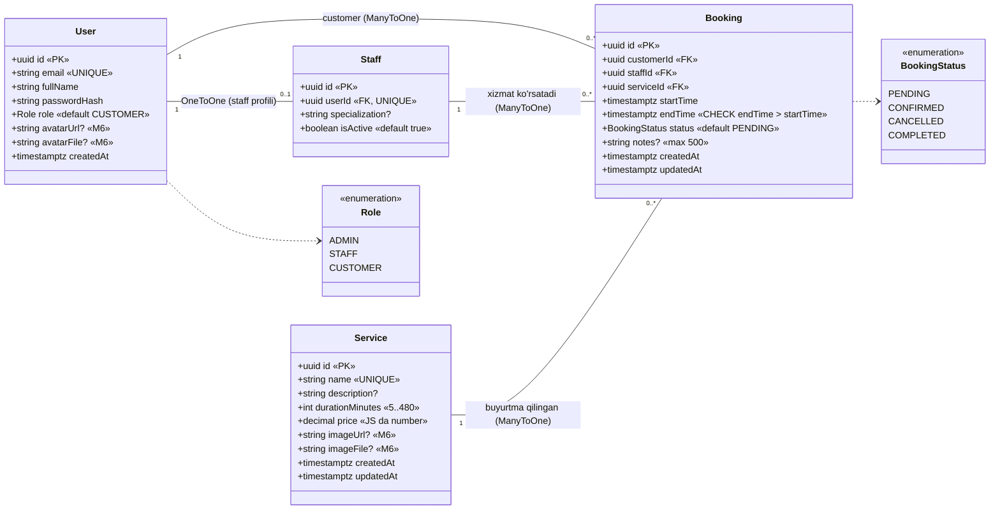
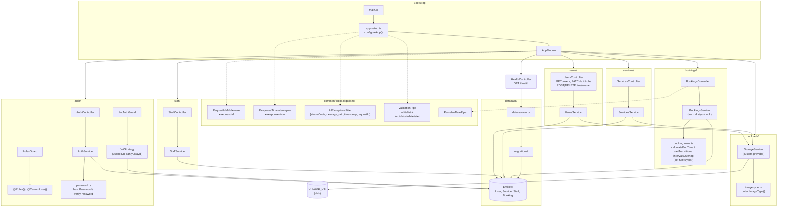
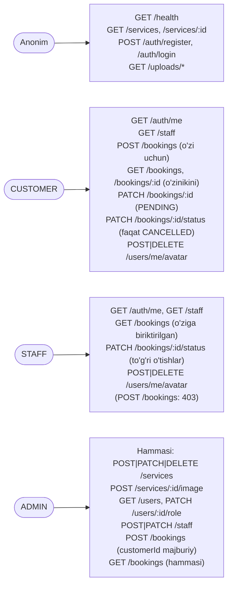
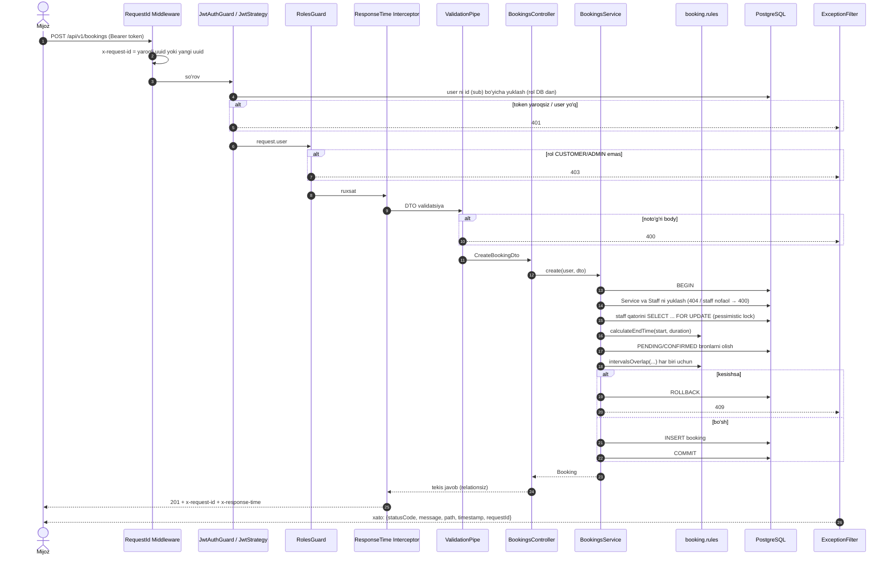
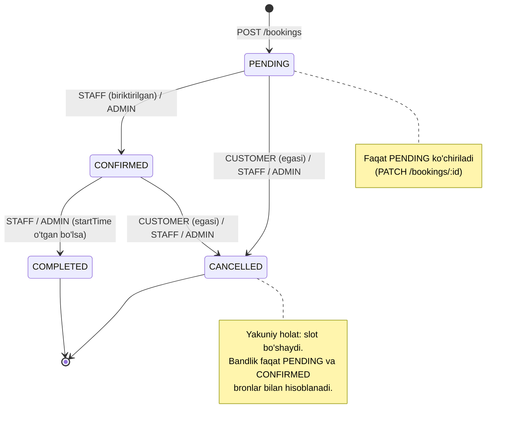
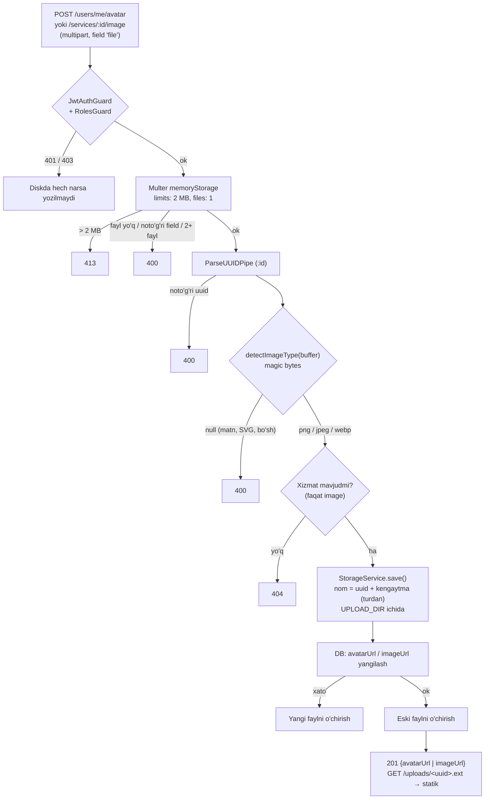
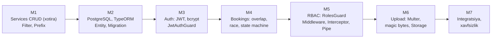

# UML: Booking & Reservation API

> Backend dasturchi uchun: entitylar orasidagi bog'lanishlar, modullar tuzilmasi, so'rov yo'li va holatlar mashinasi.
> Diagrammalar [Mermaid](https://mermaid.js.org/) formatida (GitHub, VS Code "Markdown Preview Mermaid Support" kengaytmasida ko'rinadi).
> Talablar: [ASSIGNMENT.md](ASSIGNMENT.md), [milestones.md](milestones.md).

---

## 1. Entity munosabatlari (ER / klass diagrammasi)

Entity klass nomlari testlar uchun aynan `User`, `Service`, `Staff`, `Booking` bo'lishi shart.



**Bog'lanish qoidalari (DB darajasida):**

| Munosabat | Turi | Cheklov |
|---|---|---|
| `Staff.user → User` | OneToOne | `UNIQUE(userId)`: bitta user ikki marta staff bo'lolmaydi (`23505`) |
| `Booking.customer → User` | ManyToOne | FK `RESTRICT`: bron bor userni o'chirib bo'lmaydi (`23503`) |
| `Booking.staff → Staff` | ManyToOne | FK `RESTRICT` (`23503`) |
| `Booking.service → Service` | ManyToOne | FK `RESTRICT`: API da **409** ga xaritalanadi |
| `Booking` | CHECK | `endTime > startTime` (`23514`) |
| `User.email`, `Service.name` | UNIQUE | `23505` → API da **409** |

---

## 2. Modullar tuzilmasi (komponent diagrammasi)



**Bog'liqlik yo'nalishi:** Controller → Service → Repository/Entity. `booking.rules.ts` NestJS va DB dan mustaqil (unit-testlanadi). `StorageService` `UsersService` va `ServicesService` tomonidan ishlatiladi; controllerlar diskka bevosita tegmaydi.

---

## 3. Endpointlar va rollar (kim nimaga kira oladi)



**Guard tartibi:** `JwtAuthGuard` (401) → `RolesGuard` (403) → Pipe/Validatsiya (400) → Servis (404/409).

---

## 4. So'rov hayotiy sikli (sequence): `POST /api/v1/bookings`



---

## 5. Booking holatlar mashinasi (state machine)

`canTransition(from, to)` aynan shu jadvalni amalga oshiradi.



Boshqa barcha o'tishlar (shu jumladan bir xil statusga o'tish) → **409**. Noma'lum status qiymati → **400**. Mijoz `CANCELLED` dan boshqa statusga o'tkaza olmaydi → **403**.

---

## 6. Overlap qoidasi (vaqt oralig'i, yarim ochiq `[start, end)`)

```mermaid
gantt
    dateFormat HH:mm
    axisFormat %H:%M
    title Staff A, mavjud bron 10:00-10:30 (PENDING)

    section Mavjud
    Bron (band)            :done, b0, 10:00, 30m

    section 409 (kesishadi)
    09:45-10:15 (boshida)  :crit, x1, 09:45, 30m
    10:15-10:45 (ichidan)  :crit, x2, 10:15, 30m
    10:00-10:30 (bir xil)  :crit, x3, 10:00, 30m

    section 201 (kesishmaydi)
    09:30-10:00 (yonma-yon oldin) :active, y1, 09:30, 30m
    10:30-11:00 (yonma-yon keyin) :active, y2, 10:30, 30m
```

`intervalsOverlap(aStart, aEnd, bStart, bEnd) = aStart < bEnd && bStart < aEnd`. Ko'chirishda (`PATCH`) tekshiruv **bronning o'zini hisobga olmaydi**.

---

## 7. Fayl yuklash oqimi (M6)



---

## 8. Test milestone'lari va qatlamlar



Har bir `test:mN` o'zidan oldingi barcha milestone testlarini ham ishga tushiradi (regressiya).
